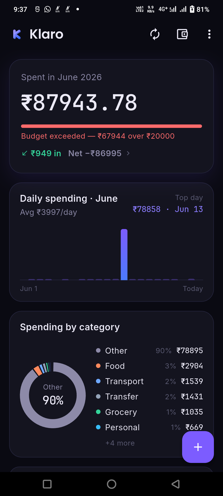
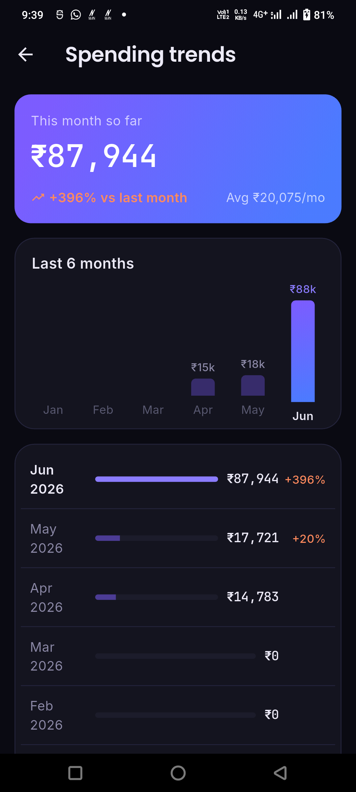
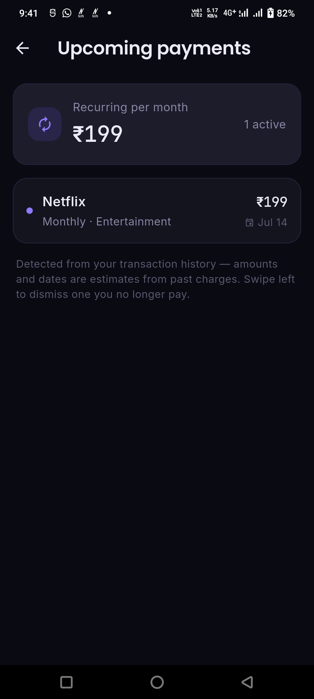
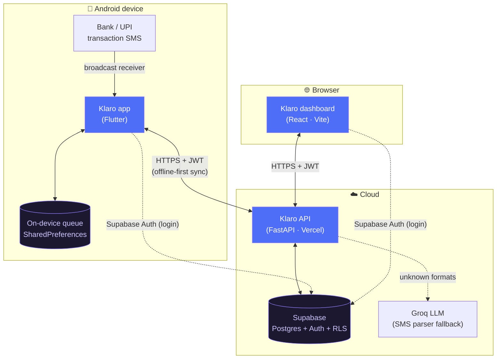

<div align="center">


# Klaro — Expense Tracker

**The expense tracker you never have to think about.**
Klaro turns the transaction SMS your bank already sends into an effortless,
automatic record of where your money goes — no receipts, no spreadsheets, no
typing in every coffee.

[](https://flutter.dev)
[](https://dart.dev)
[](https://github.com/prem-maradiya/klaro-backend)
[](https://github.com/prem-maradiya/klaro-dashboard)
[](#)
[](LICENSE)

</div>

---

## Why Klaro

Most expense trackers fail for the same reason: they make *you* do the data entry.
Klaro flips that. The moment a debit or credit alert lands on your phone, it's
parsed on-device and logged — amount, merchant, date, and direction — before you've
even put your phone back in your pocket. It recognises the major Indian banks and
UPI apps, dedupes repeat alerts so nothing is double-counted, and quietly learns the
categories and names you prefer.

> The best expense tracker is the one you never have to think about.

## Highlights

| | |
|---|---|
| 📩 **Automatic capture** | Reads bank/UPI transaction SMS and extracts amount, merchant, date & direction — zero manual entry. |
| 🧠 **Learns your habits** | Remembers the categories and merchant names you correct, and applies them next time. |
| 📊 **See where it goes** | Monthly category donut, daily-spend chart, 6-month trends, and income-vs-spending net flow. |
| 🎯 **Budgets** | Overall or per-category monthly limits with a heads-up notification as you approach them. |
| 🔁 **Recurring detection** | Spots subscriptions, EMIs and regular bills and predicts the next due date — swipe to dismiss. |
| 🔒 **Privacy-first** | Data stays on your device (and, optionally, a backend *you* control). No ads, no third-party trackers. |
| ☁️ **Optional sync** | Connect your own server to view, search, edit and export transactions from a web dashboard. |

## Screenshots

> _Captured on a Vivo (Android 12). See [`docs/screenshots/`](docs/screenshots)._

| Home & summary | Trends | Upcoming payments |
|:---:|:---:|:---:|
|  |  |  |

---

## Architecture

Klaro is one product across three repos: the **Flutter app** (this repo) does the
on-device SMS capture, a **FastAPI backend** provides multi-tenant sync + an AI
parser fallback, and a **React dashboard** offers a web view of the same data.
Identity, storage and row-level isolation are handled by Supabase.



**Source-agnostic ingestion.** Every transaction — whether from a parsed SMS, a
manual entry, a pasted/forwarded message, or a future bank-statement import — is
funneled through one `TxnCandidate` contract and a single `ingest()` pipeline
(*dedupe → categorize → learn → store*). Adding a new source means producing a
candidate, not touching the storage logic.

**Two build flavors, one codebase.** A compile-time flag (`kSmsEnabled`) and Gradle
product flavors split the app in two:

- **`full`** (direct APK) — keeps `READ_SMS`/`RECEIVE_SMS` for real-time auto-capture.
- **`play`** (Play Store) — ships with **no SMS permission at all**; users import via
  paste/forward to the compliant `POST /ingest/text` endpoint.

## Tech stack

- **App:** Flutter 3.7 / Dart 3.7 · Provider (state) · `another_telephony` (SMS) ·
  `flutter_local_notifications` · `shared_preferences` (offline queue) ·
  `connectivity_plus` (auto-sync on reconnect) · `supabase_flutter` (auth) ·
  `sentry_flutter` (opt-in error tracking)
- **Backend:** FastAPI · SQLAlchemy 2.0 · psycopg3 · Supabase Postgres ·
  Supabase Auth (ES256 JWT verified via JWKS) · SlowAPI (rate limiting) ·
  Groq (LLM parser fallback) · deployed serverless on Vercel —
  [**klaro-backend**](https://github.com/prem-maradiya/klaro-backend)
- **Dashboard:** React + Vite · Tailwind CSS · Recharts · Framer Motion —
  [**klaro-dashboard**](https://github.com/prem-maradiya/klaro-dashboard)

## Project structure

```
lib/
├── config/      Build flags (kSmsEnabled), brand links
├── models/      Expense, budget, recurring data models
├── providers/   ExpenseProvider — state, sync, offline queue
├── screens/     home, trends, budgets, recurring, label, auth, settings
├── services/    sms · api · auth · budget · contacts · notification
├── theme/        Klaro design system (dark, gradient brand)
├── widgets/     Reusable UI (charts, sheets, cards)
└── main.dart    Entry point + Sentry bootstrap
```

---

## Getting started

### Prerequisites
- Flutter 3.7+ (`flutter doctor` clean)
- An Android device or emulator (Android 7+)

### Run the SMS-capture (`full`) build

```bash
flutter pub get
flutter run --flavor full --dart-define=KLARO_SMS=true
```

### Run the Play-compliant (`play`) build (no SMS)

```bash
flutter run --flavor play --dart-define=KLARO_SMS=false
```

### Build a release APK

```bash
flutter build apk --release --flavor full --dart-define=KLARO_SMS=true
```

### Optional compile-time defines
| Define | Purpose |
|---|---|
| `KLARO_SMS` | `true` enables on-device SMS capture (default for `full`). |
| `SENTRY_DSN` | Enables opt-in error tracking; a no-op when unset. |

The app works fully offline against its on-device queue; point it at a backend in
**Settings** to enable sync and the web dashboard.

## Privacy

Klaro processes financial data **on-device**. It's transmitted only to a backend
*you* configure, over HTTPS, scoped to your account by a verified JWT. No ads, no
third-party trackers, data never sold.
[Full privacy policy »](https://klaro-dashboard.vercel.app/privacy.html)

## Roadmap & docs

- [`ROADMAP.md`](ROADMAP.md) — phase-by-phase build log (Phases 1–7 shipped)
- [`PHASE7_CLOUD_PLAN.md`](PHASE7_CLOUD_PLAN.md) — multi-tenant cloud plan + ADRs
- [`STORE_LISTING.md`](STORE_LISTING.md) — Play Store listing & permission rationale

## License

MIT © Prem Maradiya — see [`LICENSE`](LICENSE).

<div align="center"><sub>Built with Flutter · Made for people who hate doing data entry.</sub></div>
